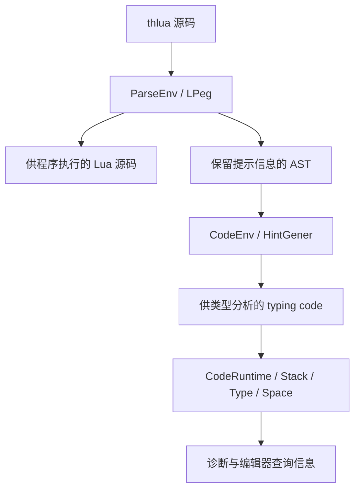

# TypeHintLua 架构与源码阅读导引

本文记录已从当前源码核实的结构、调用链和阅读要点，供首次接触项目或缺少历史上下文时使用。它不是完整的语言规范；细节以实现和回归用例为准。构建与分发说明见 [Rust 主程序文档](../rust/README.md)，贡献约定见 [AGENTS.md](../AGENTS.md)。

## 1. 先建立整体认识

- **语言实现主要由 thlua 自举。** `thlua/` 中的解析、类型检查和编辑器业务是阅读重点。
- **Rust 是宿主与分发入口。** `rust/` 管理 Lua VM、模块嵌入、原生能力桥接、CLI 和 LSP 传输，并未重写类型推导算法。
- **启动编译器是普通 Lua。** `thlua/code/ParseEnv.lua` 可以先由 Lua 加载，再用于编译其余 `.thlua` 模块，因此启动不依赖已有的 thlua 可执行文件。
- **编译与类型检查是独立操作。** `compile` 转换源码，`check` 执行类型分析，`run` 转换后执行用户代码；`run` 不会自动先完成类型检查。
- **仍然使用 C 实现的 Lua 和 LPeg。** Lua 由 mlua 的 vendored 依赖构建，仓库只保留 LPeg 源码及三份 Lua 公共头文件。旧 luv、lpath、RapidJSON 等原生实现已经移除。

## 2. 阅读 thlua 时常见的记号

| 写法 | 阅读方式与注意事项 |
| --- | --- |
| `const value:Integer = 1` | 带类型提示的局部声明；转换后的 Lua 使用 `local`。不要把编译成功当作类型检查通过。 |
| `function f(a:Integer):Ret(String)` | 参数与返回值提示；Lua 多返回值相关逻辑集中在 `tuple/`。 |
| `(@let.A = Struct {...})`、`(@do ... end)` | Hint Space 中的赋值、调用或代码块，用于构造类型和提示。 |
| `$value` | 在提示空间中取得表达式的类型信息，类似 `decltype` 的阅读方式。 |
| `let`、`namespace()` | 类型提示所用的名字空间与引用机制；入口是 `space/LetSpace.thlua` 和 `NameReference.thlua`。 |
| `import("module")`、`import($module).clazz` | 获取模块关联的类型空间；结合 `CodeRuntime:import` 阅读，不要直接等同于宿主 Lua 的 `require`。 |
| `value @ T` | 协变转换：以能够包含原类型的目标类型来看待该值。 |
| `value @! T` | 忽略 nil 的协变转换；属于不安全提示。`nil @! T` 在执行代码里仍是 nil，不会创建 T 的实例。 |
| `value @> T`、`value @? T` | 分别表示逆变转换、强制转换；不能把所有 `@` 写法统一解释为同一种断言。 |
| `value!` | 排除符号或索引结果中的 nil 情况。 |
| `f@<T>(value)` | 泛型参数；类型模板还可以通过 `Template(function(...) ... end)` 定义。 |
| `function.open`、`function.nocheck` | 函数检查模式提示。具体行为应继续追踪函数类型与 stack 实现，不能按其他语言的同名概念推断。 |
| `function:class(T)`、`{.class ...}` | 类构造及实例表相关提示；`thlua/class.thlua` 同时包含真实的 Lua 类辅助逻辑和类型提示。 |

最直接的语法样例是 `examples/1_1_syntax_hint.thlua`、`1_2_syntax_cast.thlua`、`3_template.thlua`；说明更完整的中文资料位于根目录 `README.txt`。

## 3. 两条代码生成路径

### 转换为执行代码

`rust/main.rs` → `Runtime::compile` → `ParseEnv.compile` → `ParseEnv.parse` → `ParseEnv:genLuaCode`。

LPeg 解析规则位于 `thlua/code/ParseEnv.lua`。解析过程同时构造 AST 和代码变换信息，输出 Lua 时移除类型提示，并处理 `const`、`continue` 等扩展。`compile` 成功返回 Lua 字符串，失败返回 `nil, message`；底层 `parse` 成功返回 `AST, luaCode`，失败返回 `false, errorNode`。

### 生成并运行类型计算脚本

`rust/check.lua` → `CodeRuntime:promiseMain` → `_cacheLoadFile` → `CodeEnv.new` → `CodeEnv:callTypingFn`。

`CodeEnv` 内部会调用 `ParseEnv.parse`，补充节点位置和父子关系，运行 `SearchVisitor`、`SymbolVisitor`，再由 `HintGener` 生成 typing code。`CodeEnv:_buildTypingFn` 使用 Lua `load` 加载该脚本；`callTypingFn` 传入节点列表、分析栈和全局项，得到用于后续分析的函数类型对象。

**typing code 与用户程序的执行代码用途不同。** 它调用分析栈上的类型操作，并处理提示空间。调试时可从 `CodeEnv:getTypingCode()` 观察生成内容，避免只检查擦除类型后的 Lua。类型检查期间会执行提示脚本，也要区分提示中的宿主函数调用与被分析程序的函数调用。

## 4. 类型检查模块如何协作

| 模块 | 已确认的职责与入口 |
| --- | --- |
| `runtime/CodeRuntime.thlua` | 组织单次检查，加载标准库和依赖模块，维护加载缓存，汇总诊断。`CodeRuntime` 是类型分析运行环境，不是 Lua VM。 |
| `type/TypeManager.thlua` | 创建与管理类型；细分类别位于 `basic/`、`union/`、`object/`、`func/`。 |
| `stack/` | 承接 typing code 发出的分析操作；从 `BaseStack.thlua` 及其 builder、context 继续追踪。 |
| `term/` | 表达式分析结果与变量条件。`RefineTerm` 保存类型及类型分支对应的 `VariableCase`，不仅是一个简单类型标签。 |
| `tuple/` | 函数参数、返回值和可变参数相关的元组表示。 |
| `space/` | 提示环境、名字引用、类型模板和延迟求值相关对象。 |
| `schedule/` | 使用 Lua coroutine、HintTask、SealTask 和事件依赖推进检查；`promiseSchedule` 通过异步回调安排后续工作。 |

`CodeRuntime:promiseMain` 初始化 TypeManager、StackManager、SpaceManager，加载标准库声明，再分析根文件。`StageApi` 中的 `searchPath`、`parseFile`、`parseGlobal`、`createAsync` 等接口使同一检查器能够服务于 CLI、LSP 等入口。

标准库的特殊之处：`thlua/global/*.thlua` 通常返回一段声明文本，检查器再把文本交给 `CodeEnv`。用户工程的 `throot.thlua` 则通过提示中的 `setPath(...)` 配置依赖搜索路径，并以 `require` 指定检查入口；不要把仓库自己的 `throot.thlua` 当成通用工程模板。

## 5. Rust 启动、自举与兼容桥接

1. `rust/build.rs` 扫描 `thlua/`，生成嵌入源码清单，并静态编译 LPeg；`.d.thlua` 不作为运行模块注册。
2. `Runtime::new` 创建 mlua VM，注册 LPeg 及 `host.rs` 提供的宿主模块。
3. 先加载普通 Lua 编写的 `ParseEnv.lua`，再把自举模块注册到 `package.preload`；首次 require 时编译 `.thlua`，结果由 Lua 模块机制缓存。
4. 调用 `ParseEnv.patch`，使运行中的用户模块也能通过 Lua 搜索机制加载 `.thlua` 文件。

`luv`、`path`、`chrono`、`rapidjson` 这些 require 名称仍然出现在源码中，但 Rust 宿主提供的是兼容接口，而非原来的 C/C++ 库。只保证当前工程所需接口，不能假定支持完整 libuv 或 lpath API。

特别注意：Rust 入口替换了 `thlua.server.json` 与 `thlua.server.stdio` 的实现。原文件里的 RapidJSON 转换和 luv 管道逻辑不是当前可执行文件的实际传输路径。发布配置中的 `panic = "unwind"` 也是已验证的约束，参见 `rust/README.md`。

## 6. LSP 的实际入口

当前调用链是 `rust/main.rs` → `rust/lsp.rs::serve` → `rust/lsp.lua` → `LangServer` 的方法处理表 → `ApiProvider`。

Rust 负责 Content-Length 帧、JSON-RPC 分发和 shutdown/exit 生命周期。独立输入线程将消息放入有界通道，Lua 业务和调度回调在同一工作线程运行。它不使用旧 `boot.runServer` → `LangServer:mainLoop` 的传输循环。

- `server/FileState.thlua` 管理文档内容、版本和解析状态。
- `server/ApiProvider.thlua` 处理文档通知、重新检查、发布诊断及 hover、补全、定义查询；重新检查时会取消旧的忙碌 runtime。
- 未传 `--global` 时，`rust/lsp.lua` 使用内嵌标准声明及 `thlua://global/` URI；传入时使用磁盘声明。仓库 VS Code 扩展默认传入 `server/global/`，方便跳转打开文件。
- LSP stdout 仅允许协议消息。程序使用 Rust 通道与协作队列，没有引入 Tokio；编辑后重新检查的取消逻辑也不等同于完整支持所有 LSP 请求取消。

## 7. 按问题选择阅读入口

| 问题 | 建议先读 |
| --- | --- |
| 新语法、提示擦除、生成 Lua 异常 | `ParseEnv.lua`，再看对应 `examples/` 用例 |
| 类型计算代码生成异常 | `CodeEnv.thlua`、`HintGener.thlua`、对应 stack 操作 |
| 类型兼容、表或函数推导异常 | `TypeManager.thlua`，再进入对应类型类及 `stack/context/` |
| 分支收窄或多返回值异常 | `term/RefineTerm.thlua`、`VariableCase.thlua`、`tuple/` |
| 名字未解析、递归类型、调度停滞 | `space/NameReference.thlua`、`LetSpace.thlua`、`schedule/` |
| 打包后缺模块、桥接行为不一致 | `rust/build.rs`、`runtime.rs`、`host.rs` |
| LSP 挂起、消息损坏、文档诊断不更新 | `rust/lsp.rs`，再看 `FileState`、`ApiProvider` |

验证入口见 `AGENTS.md`。`test/rust_cli.py` 使用 Python unittest 验证独立程序；`test/case*/` 是语言回归用例，`thlua/TestCase.thlua` 识别行尾 `--E` 标记。历史 `test.py` 依赖 pyskynet，不能直接视为无依赖的 Cargo 测试入口。

## 8. 尚需按任务继续核实的部分

本文没有证明完整类型系统的正确性，也没有穷尽 Open/Seal/Auto 各种函数和表类型的差异。修改泛型实例化、递归依赖、类型包含关系、分支收窄或提示执行环境时，应阅读相应实现并补充最小回归用例；不能仅依据命名或其他语言的直觉下结论。

更新本文时，优先记录稳定的入口、职责、实际调用关系和可复现的行为。尚未验证的推断单独标注；调用链或宿主替换发生变化时同步更新，避免把历史实现描述成当前行为。
