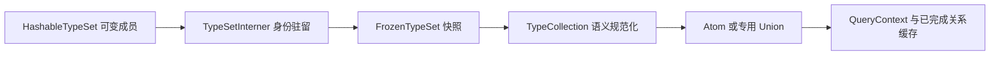

# 类型与类型集合运算

## 决策与范围

2026-11-17，根据 `goal/` 的复现、类型实现和调用方审查，采用**保留类型表示、重构运算边界**的方案。无需把算法迁入 Rust，也无需引入同一类型的多个代理对象。保留基础类型、字面量联合、Complex/Falsable/Object/FuncUnion、函数参数逆变与返回协变、Struct 字段不变、Interface 字段协变，以及 HintTask/SealTask 的自举流程。

仅在原方法内打补丁可以修复 G01/G09，但无法同时约束缓存、集合所有权、递归假设和调度。全量替换则会同时改变类身份、以对象为键的数据流事实、递归引用和未完成推导状态，风险超出这些问题所需。本次将职责拆开，旧接口通过适配层继续工作。

本文描述已实现的契约；并未证明整个语言类型系统完备或健全。没有实现通用交叉类型、语义补集或增量依赖失效算法。

## 审查的实现与调用链

| 范围 | 与本次运算的关系 |
| --- | --- |
| `type/basic/` | 原子身份、基础类型包含、Integer/Number/String 对字面量的吸收、Nil/False/Truth 投影 |
| `type/union/` | 联合分区、成员遍历、见证选择、对象/函数包含化简、交集分支聚合 |
| `type/object/` | Struct 不变字段、Interface 协变字段、递归结构关系、ClassTable 到接口的转换；Open/Seal/Auto 表另有推导状态 |
| `type/func/` 与 `tuple/` | 参数与返回元组的变型、递归函数比较、成员函数绑定、泛型实例缓存、Open/Auto/Seal 的构建过程 |
| `space/BaseTypeCom`、`AsyncTypeCom`、`AutoHolder`、`NameReference` | 名字赋值、成员集合就绪、规范化结果就绪；三者不能合并成一次递归等待 |
| `schedule/` | 关系和类型解析可能等待；注册任务与普通 coroutine 有区别 |
| `term/RefineTerm`、`VariableCase`、`ImmutVariable` | 匹配类型对象是 `_typeToCase` 的键；变量事实合并需要交集，不能把见证改成 Boolean |
| `stack/context/`、builder、`type/native` | 赋值/转换、对象键合并、返回约束、逻辑收窄与标准库原生操作消费类型运算结果 |

Rust 仍只承担宿主、嵌入和传输。没有改动 LPeg、vendored Lua、release unwind 或 LSP stdout 约束。

## 成员身份与类型语义分开

`HashableTypeSet` 只维护 `TypeId → atom`、数量和哈希，不保存类型结果。`initFromAtom` / `initFromUnion` 都是添加成员，因此在非空 Builder 上调用也不会覆盖已有成员的语义结果。重复添加不改变集合。

`FrozenTypeSet` 复制成员，之后成员固定；它可以延迟缓存规范化结果。Builder 后续添加不会改变旧快照。`getDict()` 为兼容接口，返回副本。内部优先用 `atoms()` / `foreach()`，迭代器只返回成员，不能取得底层表作为遍历状态。直接写私有 `_...` 字段、使用 rawset/debug 修改内部对象不属于受支持的 API。

`TypeSetInterner` 按哈希分桶，在完整比较所有成员身份后才复用；命中不调用 `frozen()`。哈希冲突不会证明相等。空集合也携带所属管理器。`unifyTypeSet` 保留旧名称，但其含义是身份驻留，不是语义等价。

集合层提供以下**按成员身份**的运算，均返回驻留后的冻结集合，并检查所有权：

| API | 含义 |
| --- | --- |
| `findAtom(atom)` | 精确成员查询，返回该 atom 或 false |
| `containsSet(right)` | 是否包含 right 的每个成员身份 |
| `unionSet(right)` | 成员并集 |
| `intersectSet(right)` | 成员交集 |
| `subtractSet(right)` | 成员差集 |

例如 `{Integer}` 与 `{Literal(1)}` 的身份交集为空，而类型交集为 `Literal(1)`。`subtractSet` 不是从 Integer 中排除数值 1 的语义差集。

`TypeCollection` 负责基础类型吸收字面量、去重、真假/nil 分区及对象/函数的包含化简。不同集合可以产生相同类型，如 `{Integer, Literal(1)}` 和 `{Integer}`。规范化为单个成员的浮点、字符串、对象或函数联合返回原子，避免人为保留单成员 Union。互不包含但有交集的 Interface 可以共同保留在 ObjectUnion 中。AnyFunction 吸收函数分支时与插入顺序无关。

## 包含判断与匹配见证

| API | 返回与用途 |
| --- | --- |
| `type:includeAll(right)` | Boolean，左侧是否包含 right 的全部分支；Never 是任意类型的子类型 |
| `type:containsAtom(atom)` | Boolean，是否有覆盖 atom 的分支 |
| `type:findCoveringAtom(atom)` | 覆盖 atom 的左侧原子，或 false；用于键值映射与分支事实 |
| `type:includeAtom(atom)` | 上述见证接口的兼容别名，不能写 `== true` |

语义等价使用双向 `includeAll`。对象身份相同或同一管理器中的驻留集合相同是更强的实现条件，不能反过来要求所有语义等价类型必须同一个 Lua 对象。存在多个覆盖分支时，见证接口只保证返回其中一个；不承诺唯一或固定顺序。

## 交集结果

`type:intersectResult(right)` 返回 `IntersectionResult`：

| `getKind()` | `getType()` | 含义 |
| --- | --- | --- |
| `empty` | Never | 已确认不相交 |
| `exact` | 非 Never 的类型 | 能返回准确的交集类型 |
| `overlap` | false | 已知非空，但当前算法未获得准确的可表示类型 |

交集先处理相同类型和包含吸收，再对两侧联合分配到原子对。任一原子对只报告 overlap 时，不能丢弃该分支，不能仅返回其他分支的部分交集，也不能把空 Builder 当作证明生成 Never。`A & (B | Nil)` 和 `(A | Nil) & (B | Nil)` 都保留这种状态。

`safeIntersect` 保留兼容协议：返回类型或 false。这里 false 是 overlap，Never 才是 empty。`checkedIntersect` 在 overlap 时明确抛错，不制造不准确的类型。`intersectSome` 判断非空时排除 Never 对象，修复了函数联合把空交集当作 truthy 值的问题。

当前限制：两个互不包含的 Interface 即使可以同时满足，通常仍返回 overlap。用户显式组合对象仍可用 `ExtendInterface`，但它不是任意类型交集的通用替代：元事件冲突、不可满足字段和递归字段还受既有规则约束。未来若扩展可表示交集，应扩展原子算法及回归，而非改变 empty 的含义。

## 就绪核心与解析层

| API | 等待契约 |
| --- | --- |
| `tryResolveType(type)` | 非等待查询；未得到最终类型返回 false，false 不表示 Never |
| `resolveType` / `resolveUnion` / `resolveIntersect` | 可以等待；只有实际需要等待时才要求已注册的检查器任务 |
| `unionReady` / `intersectReady` | 仅接受已初始化的 Atom/Union；包括隐藏结构依赖在内，禁止实际等待 |
| `checkedUnion` | `resolveUnion` 的兼容别名 |
| `buildUnion` | 在 HintTask 中异步构建；成员集合与最终类型分别发布 |

`intersectReady` 返回 IntersectionResult。即使外层对象已经有 TypeId，字段或结构关系仍可能未就绪；这时 ready 操作明确失败。Resolver 可以等待依赖完成后重试。失败前不向事件等待队列加入未注册任务；等待禁令按 coroutine 保存并在异常后清理，同时抑制 SealTask 排队时的协作 yield。已完成事件在 ready 操作中仍可读取。

这些接口不会强制等待递归子类型全部展开。`getSetAwait` 与 `checkAtomUnion` 的两阶段边界保留，防止把合法递归误变成调度环。ready 失败可以留下可复用的驻留快照或已安排的关系任务，但不会发布未经证明的关系结果；之后 Resolver 可以继续完成它。

## 递归上下文与缓存

`QueryContext` 管理两组互相隔离的临时命题：有方向的包含和对称的相交。沿当前路径再次遇到同一命题时使用共递归假设；离开路径时删除，失败与异常也会清理。假设不作为某个兄弟分支的永久证明。

`TypeRelation` 为两个方向的包含及相交分别创建上下文。只有完整比较结束后才设置 `_result`、唤醒依赖，并由 `TypeManager` 缓存最终对象关系。在递归查询里不会等待另一个仍未完成的关系任务，而是沿当前上下文比较，避免互相等待。

## 所有权和可变性

TypeId 只在一个 TypeManager 内有效。集合插入/合并/驻留、公开关系入口、解析及关系缓存键拒绝外部管理器类型；`findAtom` 也校验实际对象身份，不只按整数 ID 命中。ID 分配限制在 32 位无符号范围，避免破坏当前打包关系键。

`TypedObject:lateInit` 单次发布并复制输入字段字典和交叉来源集合；`getValueDict` 返回快照。修改应构造新描述并取得新 TypeId，而不能修改旧描述并继续使用旧关系缓存。Open/Auto/Seal 表和函数的推导状态仍可按原生命周期推进，不能一概冻结所有对象。已经驻留的 ObjectUnion/FuncUnion 拒绝继续 `putAwait`。

没有引入原生代理。G14 保留对 Lua table key 与类元表身份的保护。未来若迁入 Rust，应先保证每个引擎内同一类型复用唯一代理，或系统性替换对象键与 Class.is；仅实现代理 `__eq` 不够。

## 验证与后续扩展

`python goal/run.py --strict` 执行原始 G01–G15 和扩展 G16–G19；全部也是 `python test.py` 的正式测试，在隔离目录及独立进程运行。源码级 `types/interface_union_overlap` 额外验证解析、生成 Lua、执行与零诊断。

测试覆盖缓存失效、快照、碰撞、命中分配、匹配见证、三态交集、合法等待及拒绝隐式等待、递归关系、基础联合规律、管理器边界、代理身份保护、结构发布，以及集合代数、基础交集对称/吸收/分配、上下文清理、函数变型和联合空交集。它们不是全类型空间的证明，也没有量化性能加速。

下一次扩展若引入通用交叉类型、类型差集、跨 runtime 复用或增量检查，应分别定义其表示和依赖生命周期，不能把这些问题塞回身份集合或复用未经版本化的关系缓存。
